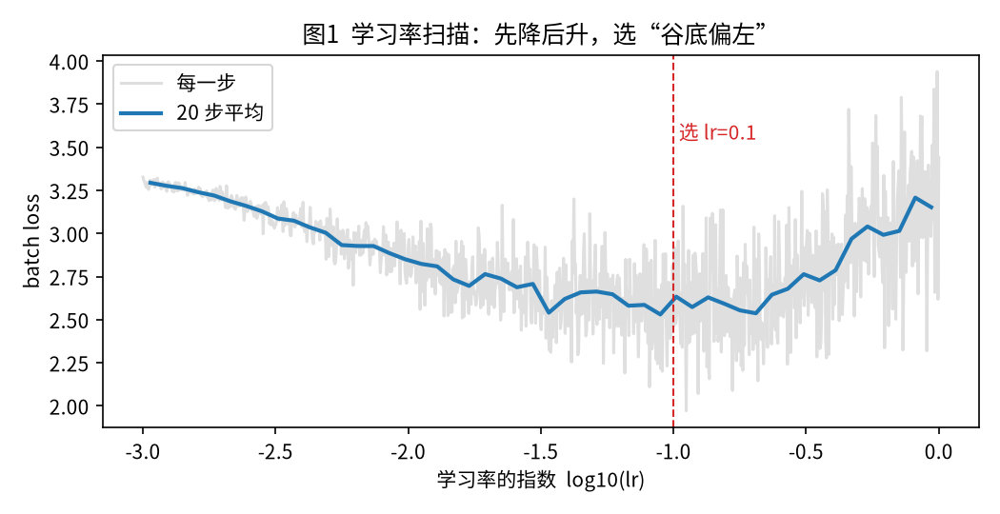
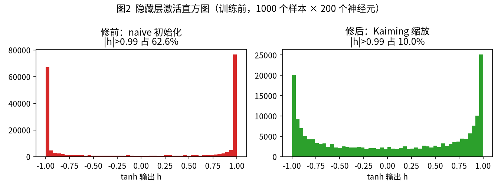
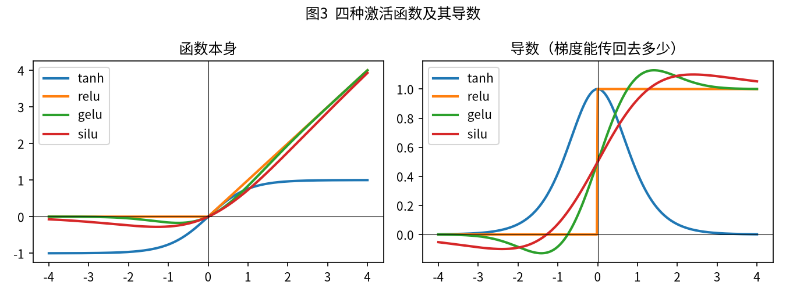
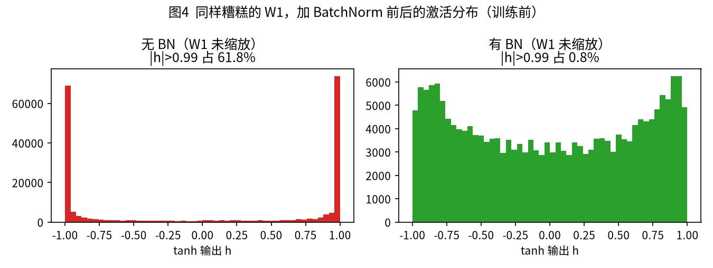
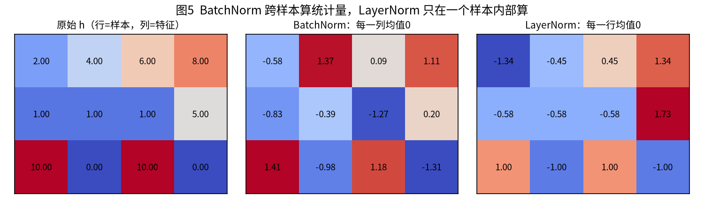

# 第 2 周补强：MLP、初始化、激活函数与 BatchNorm

<p class="sub">自顶向下 · 按需回溯 · 围绕 <code>mlp2.py</code>（字符级 MLP 造英文名字）</p>

## 怎么读这份讲义

第 1 批把 GPT 拆到了底：logits、softmax、embedding、注意力、残差、LayerNorm、交叉熵、梯度下降。这一周换一个**小到能看清每个数字**的模型：用前 3 个字母猜下一个字母，在 3.2 万个英文名字上训练，然后让它“造名字”。

它小，所以我们能盯着它的**训练过程**看：初始 loss 对不对、隐藏层是不是“卡死”了、学习率怎么挑、BatchNorm 到底改了什么。这些问题在大模型里一样存在，只是看不见。

和上一批一样，需要的数学放在回溯框里，只讲够用的那一点；完整推导一律“留给深挖章节 A”。

<div class="back" markdown="1">
**运行**：`python mlp2.py`（CPU，2 核机器上实测 117 秒；首次自动下载 `names.txt`，数据文件不入库）。终端会打印本讲义里的所有数字，并生成图 1–5。讲义中的数字全部来自这一次真实运行；回溯框里的小例子来自 `snippets.py`。
</div>

| 章 | 问题 | 回溯框 |
|---|---|---|
| 1 | 从 bigram 到 MLP，多看两个字母值多少？ | 拼接 embedding |
| 2 | 数据怎么分？学习率怎么找？为什么用小批量？ | 对数刻度 |
| 3 | 初始 loss 为什么是 25 而不是 3.3？ | −ln(1/27)、tanh 导数饱和、标准差缩放 |
| 4 | tanh / ReLU / GELU / SiLU 有什么不同？ | 导数曲线 |
| 5 | BatchNorm 做了什么？Transformer 为什么不用它？ | 跨样本 vs 单样本统计 |

---

## 第 0 章：先看它能做什么

跑完后，终端最后一段是汇总（真实输出）：

```text
瞎猜 3.2958 | bigram dev 2.4533
MLP naive 初始化   初始 25.766 → dev 2.2666
MLP Kaiming 初始化 初始 3.305 → dev 2.1410（test 2.1432）
激活函数 dev：tanh 2.1790  relu 2.1734  gelu 2.1788  silu 2.1899
W1 未缩放：无 BN dev 2.1761 | 有 BN dev 2.2077
```

最终模型造出来的名字：

```text
carmah, amilli, khi, mili, taty, halaysie, mahnen, deliah, jareen, nellara, chaiiv, kaleigh
```

`deliah`、`kaleigh`、`jareen` 已经很像真名字，`chaiiv` 这种就露馅了。这一周要搞懂的，就是上面五行数字分别说明了什么。

---

## 第 1 章：从 bigram 到 MLP

**直觉。** 上一批的 `bigram.py` 只看**前 1 个字母**猜下一个：看到 `q` 几乎一定猜 `u`。但看到 `a`，后面可能是任何字母，只看一个字母信息太少。MLP 看**前 3 个字母**（开头不足 3 个就用 `.` 补），比如 `.em` → 猜 `m`（emma）。

**结论性公式。** 一次前向只有三步：

```text
3 个编号 → 各查 embedding（每个 10 维）→ 拼成 30 维
        → 隐藏层：h = tanh(x @ W1 + b1)      30 → 200
        → 输出层：logits = h @ W2 + b2        200 → 27
```

<div class="back" markdown="1">
**回溯框 1：拼接 embedding**

上一批讲过 embedding 就是查表。这里表 `C` 是 27 行 × 10 列。一个样本有 3 个字母，查出 3 行，每行 10 个数，首尾接起来就是 30 个数：

```python
emb = C[X]                         # (B, 3, 10)  B 个样本，每个 3 个字母，每个字母 10 维
x = emb.view(X.shape[0], -1)       # (B, 30)     把后两维“摊平”成一排
```

`view` 不复制数据，只是换一种看法。拼接保留了**顺序**：第 1–10 个数永远是最早那个字母，所以模型分得清 `.em` 和 `me.`。
</div>

**代码**（`mlp2.py` 的 `forward`，去掉 BN 分支后）：

```python
emb  = p['C'][X].view(X.shape[0], -1)     # (B, 30)
hpre = emb @ p['W1'] + p['b1']            # (B, 200)  激活前
h    = torch.tanh(hpre)                   # (B, 200)  激活后
logits = h @ p['W2'] + p['b2']            # (B, 27)
```

**真实对比**（同一份数据划分）：

| 模型 | 看几个字母 | 参数量 | dev loss |
|---|---|---|---|
| 瞎猜（均匀分布） | 0 | 0 | 3.2958 |
| bigram（计数 + 1 平滑） | 1 | 27×27 = 729 | 2.4533 |
| MLP（Kaiming 初始化，30000 步） | 3 | 11897 | **2.1410** |

从 2.45 降到 2.14，相当于给正确字母的平均概率从 e^(−2.45) ≈ 0.086 升到 e^(−2.14) ≈ 0.118。

**常见坑。**

- `view` 之前要确认形状是 `(B, 3, 10)`；写成 `view(-1, 30)` 在批大小变化时也能工作，但写成 `view(32, 30)` 就会在评估整个 dev 集时报错。
- 生成名字时 `ctx = ctx[1:] + [ix]`：窗口要“滑动”，别忘了丢掉最早那个字母。

**小结。** MLP = 拼接 3 个字母的 embedding + 一层隐藏层。多看两个字母，dev loss 从 2.45 降到 2.14。

---

## 第 2 章：数据划分、学习率、小批量

### 2.1 训练 / 验证 / 测试

**直觉。** 只看训练集 loss，模型可以靠“背答案”刷低分。所以 3.2 万个名字先打乱，再分三份：

| 集合 | 比例 | 样本数（字符级） | 用途 |
|---|---|---|---|
| train | 80% | 182625 | 算梯度、更新参数 |
| dev（验证） | 10% | 22655 | 挑超参数：学习率、隐藏层大小、要不要 BN |
| test | 10% | 22866 | **最后只看一次**，报告真实水平 |

本次最终模型：train 2.1115，dev 2.1410，test 2.1432。三者接近，说明没有明显过拟合；反过来，这个小模型还有“欠拟合”的空间（加大隐藏层或 embedding 维度，train 和 dev 都还能降）。

**常见坑**：按**名字**划分，不要按字符样本划分。否则同一个名字的前半截在 train、后半截在 dev，dev 就不再是“没见过的数据”。`mlp2.py` 先 `shuffle(words)` 再切，就是这个原因。

### 2.2 学习率怎么找：扫描

**直觉。** 学习率太小，走得慢；太大，一步跨过谷底甚至越走越高。与其瞎试，不如**一次训练里让学习率从很小涨到很大**，看 loss 在哪里最低。

**做法**：1000 步，第 i 步用 lr = 10^(−3 + 3i/1000)，即从 0.001 指数增长到 1。

<div class="back" markdown="1">
**回溯框 2：为什么用 10 的几次方（对数刻度）**

学习率可能的取值跨好几个数量级：0.001、0.01、0.1、1。如果均匀地从 0.001 走到 1，前 90% 的步数都花在 0.1–1 之间，小学习率根本试不到。改成**指数**均匀：横轴是 log10(lr)，−3、−2、−1、0 各占一样宽，每个数量级都试到。

```python
lre = torch.linspace(-3, 0, 1000)   # 指数从 -3 均匀走到 0
lrs = 10 ** lre                      # 0.001 ... 1
```
</div>

真实输出（每 20 步取平均）：

```text
平滑后 loss 最低处的 lr ≈ 0.089（10^-1.05）
  lr=10^-3    附近平均 loss 3.294
  lr=10^-2    附近平均 loss 2.850
  lr=10^-1.5  附近平均 loss 2.708
  lr=10^-1    附近平均 loss 2.633
  lr=10^-0.5  附近平均 loss 2.764
  lr=10^0     附近平均 loss 3.152
```



**结论**：谷底在 0.1 附近，再往右就开始抖、开始升。正式训练用 **lr = 0.1 跑 20000 步，然后降到 0.01 再跑 10000 步**（学习率衰减：先大步走到谷附近，再小步细调）。

**常见坑**：扫描曲线的横轴是“训练进度”和“学习率”混在一起的，右边 loss 高，一部分原因是前面已经训练过了。所以只用它找**大致的数量级**，不要读到小数点后两位；挑“谷底偏左”比挑正谷底更稳。

### 2.3 小批量（minibatch）

每一步不是用全部 18 万个样本算梯度，而是随机抽 32 个。真实计时：

```text
  整批 182625 条：一步 439.4 ms
  小批 32 条：一步 0.8 ms
```

小批量的梯度是“有噪声的估计”，方向大致对，但**快了 500 多倍**。同样的时间里，走很多步“差不多对”的路，比走一步“完全对”的路有用得多。第 1 批 `gpt.py` 里的 `get_batch` 是同一个思路。

**小结。** 按名字分三份；用对数刻度扫学习率，选谷底偏左的 0.1；用 32 条的小批量换速度。

---

## 第 3 章：初始化——第一步就不该错

**直觉。** 训练还没开始，模型什么都没学，它对 27 个字母应该**一视同仁**。这时 loss 应该等于“瞎猜”的值。如果第 0 步的 loss 远大于这个值，说明模型一开始就在**自信地猜错**。

<div class="back" markdown="1">
**回溯框 3a：初始 loss 为什么该是 3.30**

一视同仁 = 每个字母概率 1/27。交叉熵 = −ln(给正确答案的概率) = −ln(1/27) = ln 27 ≈ **3.2958**。

怎样让模型一开始一视同仁？让 27 个 logits **几乎相等**（比如都接近 0），softmax 之后就是均匀分布：

```python
-math.log(1/27)                                          # 3.295836866004329
F.cross_entropy(torch.zeros(1, 27), torch.tensor([5]))   # 3.2958  全 0 的 logits
```

反过来，如果某个错误字母的 logit 是 8、其余是 0（“过于自信”），而正确答案恰好不是它：

```python
lg = torch.tensor([[0., 0., 8.] + [0.]*24])
F.cross_entropy(lg, torch.tensor([0]))   # 8.0087  自信但错了
F.cross_entropy(lg, torch.tensor([2]))   # 0.0087  自信且对了
```

初始化时模型是随机的，“自信”几乎总是**错**的，loss 就会远大于 3.3。
</div>

### 3.1 问题一：logits 太大

`naive` 初始化：所有权重直接 `torch.randn`，不做缩放。真实输出：

```text
[naive]   初始 loss 25.7660；logits 绝对值均值 10.04
[kaiming] 初始 loss 3.3048；logits 绝对值均值 0.08
```

25.8 远超 3.3。修法很简单：输出层 `W2` 乘 0.01、`b2` 设 0，logits 就都接近 0，初始 loss 立刻回到 3.30。

为什么不直接设成 0？`W2` 全 0 会让隐藏层收不到任何梯度信号（上一批的链式法则：中间有一个乘 0，后面全是 0），所以只是**缩小**，不清零。

### 3.2 问题二：tanh 饱和

logits 修好了，隐藏层还有问题。看图 2 左边：naive 初始化下，**62.6%** 的 tanh 输出贴在 ±1 上。

<div class="back" markdown="1">
**回溯框 3b：tanh 的导数和“饱和”**

tanh 把任何数压到 (−1, 1)。它的导数有一个好记的公式：**tanh 的导数 = 1 − tanh(x)²**。

| x | tanh(x) | 导数 1 − tanh² |
|---|---|---|
| 0.5 | 0.4621 | 0.786 |
| 2.0 | 0.9640 | 0.0707 |
| 5.0 | 0.9999 | 0.00018 |

```python
x = torch.tensor([0.5, 2.0, 5.0], requires_grad=True)
torch.tanh(x).sum().backward(); print(x.grad)   # [7.86e-01, 7.07e-02, 1.82e-04]
```

**饱和**：输入一大，输出贴到 ±1，导数接近 0。反向传播时梯度要乘上这个导数，乘完几乎是 0：这个神经元“推不动”了，参数学不到东西。如果一个神经元对**所有**样本都饱和，它就彻底“死了”。（导数公式的推导留给深挖章节 A。）
</div>

为什么会饱和？因为 tanh 的输入 `hpre` 太大了：

```text
[naive]   hpre 标准差 5.48；|h|>0.99 的比例 62.6%
[kaiming] hpre 标准差 1.62；|h|>0.99 的比例 10.0%
```

<div class="back" markdown="1">
**回溯框 3c：为什么要除以 √n（标准差缩放）**

均值和方差上一批讲过。这里只用一个结论：**n 个“标准差为 1 的随机数”各乘一个“标准差为 1 的随机权重”再相加，结果的标准差约为 √n**。项越多，加出来的数波动越大。

隐藏层的每个输入是 30 个数（3 个字母 × 10 维）的加权和，所以 hpre 的标准差约为 √30 ≈ 5.48，正好是上面实测的 5.48。

修法：权重先除以 √n，标准差就回到 1：

```text
n=  1 不缩放 std 0.98   除以√n 后 0.95   √n=1.00
n= 30 不缩放 std 5.45   除以√n 后 1.00   √n=5.48
n=300 不缩放 std 17.35  除以√n 后 1.00   √n=17.32
```

这和第 1 批注意力里“除以 √d”是**同一件事**。（为什么是 √n：方差相加的推导，留给深挖章节 A。）
</div>

**结论性公式（Kaiming 初始化）**：

```text
W = randn(fan_in, fan_out) × gain / √fan_in
```

`fan_in` 是这一层的输入个数（这里 30）。`gain` 补偿激活函数“压缩”掉的那部分：tanh 用 5/3，ReLU 类用 √2。它让 hpre 标准差 ≈ 5/3 ≈ 1.6（实测 1.62），饱和比例从 62.6% 降到 10.0%。

**代码**（`make_mlp` 里的两种初始化）：

```python
if init == 'naive':
    p['W1'] = torch.randn((fan_in, n_hidden), generator=g)
    p['W2'] = torch.randn((n_hidden, V), generator=g)
else:
    p['W1'] = torch.randn((fan_in, n_hidden), generator=g) * gain / fan_in**0.5
    p['W2'] = torch.randn((n_hidden, V), generator=g) * 0.01
    p['b2'] = torch.zeros(V)
```



### 3.3 修前修后：训练结果

同样 30000 步、同样的学习率：

| 初始化 | 第 0 步 loss | 前 100 步平均 | train | dev |
|---|---|---|---|---|
| naive | 25.766 | 12.815 | 2.2531 | 2.2666 |
| Kaiming | 3.305 | 2.772 | **2.1115** | **2.1410** |

naive 版不仅开头浪费了大量步数去“把 logits 压下来”（这段 loss 下降很快，但只是在纠正初始化的错，什么规律都没学到），而且最终也差了 0.13。饱和的神经元在整个训练中都在拖后腿。

**常见坑。**

- **每次训练都先看第 0 步 loss。** 它应该接近 ln(类别数)。字符级 27 类是 3.30，第 1 批的 65 类是 4.17，一个 5 万词表的大模型约是 10.8。差太多就先查初始化，再谈别的。
- 饱和比例 10% 不是零，这没关系；要警惕的是一半以上贴边，或某些神经元对所有样本都贴边（本次两种初始化都是 0/200，所以 naive 的问题是“大部分时候推不动”，还没到“彻底死掉”）。

**小结。** 初始 loss 应该是 −ln(1/27) = 3.30；naive 初始化得 25.8，因为 logits 太大。tanh 输入太大会饱和、梯度消失；按 gain/√fan_in 缩放后，饱和从 62.6% 降到 10.0%，dev 从 2.2666 改善到 2.1410。

---

## 第 4 章：激活函数对比

**直觉。** 激活函数是夹在两次矩阵乘法中间的那个“折一下”（上一批的 ReLU）。不同的折法，决定了**梯度能传回去多少**。看图 3 右边的导数就够了。



**结论性公式**（只需认得形状）：

| 名字 | 公式 | 一句话 |
|---|---|---|
| tanh | (e^x − e^−x)/(e^x + e^−x) | 两头都饱和 |
| ReLU | max(0, x) | 负半边导数恒为 0 |
| GELU | x · Φ(x)，Φ 是标准正态的累积概率 | 平滑版 ReLU，负数“部分放行” |
| SiLU（Swish） | x · sigmoid(x) | 也是平滑版 ReLU |

真实导数值：

```text
  x=-3 处导数： tanh=0.010  relu=0.000  gelu=-0.012  silu=-0.088
  x=-1 处导数： tanh=0.420  relu=0.000  gelu=-0.083  silu=0.072
  x= 1 处导数： tanh=0.420  relu=1.000  gelu=1.083  silu=0.928
  x= 3 处导数： tanh=0.010  relu=1.000  gelu=1.012  silu=1.088
```

读法：

- **tanh**：|x| = 3 时导数只剩 0.010，这就是第 3 章的饱和。
- **ReLU**：正半边导数恒为 1，**永不饱和**，这是它取代 tanh 的原因。但负半边导数恒为 0，一个神经元如果对所有输入都落在负半边，就永远学不动（“死 ReLU”）。
- **GELU / SiLU**：正半边像 ReLU；负数附近导数不是硬 0，而是平滑地过渡，梯度还能漏一点回去；整条曲线没有折角，优化更平滑。

**代码**：同一个 MLP，只换激活函数（各自配对应的 gain），各训练 15000 步：

```python
ACTS = {'tanh': torch.tanh, 'relu': F.relu, 'gelu': F.gelu, 'silu': F.silu}
h = ACTS[m['act']](hpre)
```

```text
  tanh  train 2.1568  dev 2.1790
  relu  train 2.1547  dev 2.1734；训练后 h=0 的比例 67.0%
  gelu  train 2.1611  dev 2.1788
  silu  train 2.1751  dev 2.1899
```

**诚实的结论**：在这个只有 1 层隐藏层的小模型上，四者差别在 0.02 以内，属于噪声级别，**看不出谁更好**。激活函数的差别要在**深**网络里才显现：每多一层，梯度就多乘一次导数，tanh 的 0.010 乘几层就没了，ReLU 类的 1 则能一路传下去。另外注意 ReLU 训练后有 67.0% 的输出是 0，大部分神经元对大部分样本是“关着”的。

**为什么现代 LLM 用 GELU / SiLU？** GPT-2、BERT 用 GELU；LLaMA、Qwen、Mistral 用 SiLU。理由就是上面那几条：正半边不饱和、负半边不硬截断、处处平滑。而且它们不是单独用 SiLU，而是用 **SwiGLU**：把 FFN 的输入同时过两张表，一份过 SiLU 当“门”，去乘另一份。这是下一批“前沿架构”的第一个话题。

**常见坑。** 换了激活函数要同时换 `gain`（tanh 5/3，ReLU 类 √2），否则初始化又会偏。

**小结。** tanh 两头饱和；ReLU 正半边不饱和但有死区；GELU/SiLU 是平滑版 ReLU，是现代 LLM 的标配，并引出 SwiGLU。浅网络里四者差别很小。

---

## 第 5 章：BatchNorm

**直觉。** 第 3 章靠“精心挑选的缩放系数”让 hpre 标准差 ≈ 1。网络一深，每层都要算对，很脆弱。BatchNorm 的想法很粗暴：**别算了，直接在每一层把 hpre 强行标准化**——减均值、除以标准差，然后再让模型自己学一个缩放和平移。

**结论性公式**（对隐藏层的每一个神经元，在一个 batch 的 32 个样本上算）：

```text
hpre_bn = bngain × (hpre − batch均值) / batch标准差 + bnbias
```

`bngain`（初始 1）和 `bnbias`（初始 0）是可学习的，模型如果觉得“标准化过头了”，可以自己调回来。

**代码**（`mlp2.py` 的 BN 分支）：

```python
if train:                                   # 训练：用这一批自己的统计量
    mu, sd = hpre.mean(0, keepdim=True), hpre.std(0, keepdim=True)
    with torch.no_grad():                   # 顺手更新滑动平均
        m['bnmean'] = 0.999 * m['bnmean'] + 0.001 * mu.squeeze(0)
        m['bnstd']  = 0.999 * m['bnstd']  + 0.001 * sd.squeeze(0)
else:                                       # 推理：用训练时攒下的滑动平均
    mu, sd = m['bnmean'], m['bnstd']
hpre = p['bngain'] * (hpre - mu) / (sd + 1e-5) + p['bnbias']
```

`mean(0)` 的 0 表示**沿 batch 方向**（跨样本）求均值：每个神经元各自一个均值。

### 5.1 实验：同样糟糕的 W1，加不加 BN

故意把 `W1` 换回没缩放的 `randn`（第 3 章 naive 的那种），其余用 Kaiming：

```text
[无 BN] 训练前 hpre 标准差 5.48；|h|>0.99 比例 61.8%
[有 BN] 训练前 hpre 标准差 1.00；|h|>0.99 比例 0.8%
[无 BN] 训练 30000 步后 train 2.1451  dev 2.1761；训练后 |h|>0.99 比例 63.0%
[有 BN] 训练 30000 步后 train 2.2005  dev 2.2077；训练后 |h|>0.99 比例 1.3%
```



**激活分布**：BN 把 hpre 标准差从 5.48 拉回 1.00，饱和从 61.8% 降到 0.8%，训练后也保持在 1.3%。不需要任何人算 gain。

**但 loss 没有变好**，dev 反而差了 0.03。这是真实结果，不是笔误。原因：这个网络只有 1 层，没有 BN 也能硬学（训练后仍有 63% 饱和，但输出层照样把 loss 压到了 2.18）；而 BN 用 32 个样本估计均值方差，会带来额外噪声，推理时用的滑动平均和训练时每批的值也不完全一致。**BN 的价值在深网络**：几十层叠起来时，它让每一层的分布都稳住，没有它可能根本训不动。在一层的小网络上，它只是“更稳”，不是“更好”。

### 5.2 训练 / 推理行为不同

训练时，一个样本的输出取决于**和它同批的其他 31 个样本**（因为均值方差是它们一起算的）。推理时只有一个样本，算不出有意义的方差，所以改用训练时攒的滑动平均。真实输出（同一个样本的前 3 个 logits）：

```text
  推理模式，单独喂              [-2.868, 1.812, 0.536]
  推理模式，混在 64 条里        [-2.868, 1.812, 0.536]
  训练模式，和第 1 批 64 条一起 [-2.522, 1.743, 0.518]
  训练模式，和另一批 64 条一起  [-2.792, 1.876, 0.508]
```

推理模式下结果稳定；训练模式下，换一批“同学”，同一个样本的输出就变了。PyTorch 里这就是 `model.train()` / `model.eval()` 的区别，忘了切 `eval()` 是 BN 最经典的 bug。

### 5.3 为什么 Transformer 改用 LayerNorm / RMSNorm

<div class="back" markdown="1">
**回溯框 5：跨样本统计 vs 单样本统计**

把一批激活看成表格：行 = 样本，列 = 特征。

- **BatchNorm 按列**归一化：每个特征，在这一批所有样本上算均值方差。
- **LayerNorm 按行**归一化：每个样本，在自己的所有特征上算均值方差（上一批第 6 层讲过）。



**RMSNorm** 是 LayerNorm 的简化：不减均值，只除以“平方的平均再开方”（均方根）。对 [2, 4, 6, 8]：

```python
h / h.pow(2).mean().sqrt()   # [0.3651, 0.7303, 1.0954, 1.4606]
F.layer_norm(h, (4,))        # [-1.3416, -0.4472, 0.4472, 1.3416]
```

少算一步，效果相当，LLaMA 系列都用它。
</div>

BN 在 Transformer 里的三个麻烦，LN/RMSNorm 都没有：

| 问题 | BatchNorm | LayerNorm / RMSNorm |
|---|---|---|
| 依赖 batch | 批小了统计量就不准；单条推理只能靠滑动平均 | 每个 token 自己算，与 batch 无关 |
| 变长序列 | 序列长短不一、有 padding，“跨样本的同一位置”没有统一含义 | 只看当前 token 自己的向量 |
| 训练 / 推理一致 | 两套行为，容易出 bug | 训练、推理完全同一个公式 |

你用 llama.cpp / Ollama 跑模型时，一次只生成一个 token、batch 常常是 1，还要配合 KV cache 一个位置一个位置往前推。这种场景下，“必须看同批其他样本”的 BN 根本没法用，LN/RMSNorm 则天然适合。

**常见坑。**

- 推理前忘记 `model.eval()`，或者自己写 BN 时推理分支仍用 batch 统计量。
- 加了 BN 之后，它前面那层的 bias（`b1`）就没用了：减均值时会被减掉。Karpathy 的版本会直接去掉它。
- 用 BN 的模型，batch 大小本身成了一个超参数。

**小结。** BN 在每层强行把激活标准化，让分布不依赖精心的初始化；训练用 batch 统计量、推理用滑动平均。它依赖 batch，不适合变长序列和逐 token 推理，所以 Transformer 用只看单个样本的 LayerNorm / RMSNorm。

---

## 本周完成标准

1. **跑通**：`python mlp2.py`，看到第 0 章那五行汇总、12 个名字和五张图（或者让我替你跑）。

2. **用自己的话回答**（几句话，不需要公式）：

    - 字符级 27 类模型，初始 loss 为什么应该约等于 3.3？如果是 25，说明什么、怎么修？
    - tanh 饱和是什么？为什么饱和的神经元学不动？
    - BatchNorm 和 LayerNorm 的区别是什么？为什么 Transformer 用 LayerNorm/RMSNorm？

3. **可选实验**（任选一个，说说看到了什么）：

    - 把 `n_hidden` 从 200 改成 400，或 `n_embd` 从 10 改成 20：dev 能降到多少？train 和 dev 的差距变大了吗？
    - 把 `block_size` 从 3 改成 5（看前 5 个字母）。
    - 把 Kaiming 的 `gain` 从 5/3 改成 1 或 3，看饱和比例和 dev loss 怎么变。
    - 把 MLP 改成 4 层隐藏层，再比较“无 BN / 有 BN”和四种激活函数：差距是否拉开了？

完成后把回答发给我。下一批就是**前沿架构**：从 SwiGLU 开始（本周第 4 章的伏笔），再到 RMSNorm、RoPE、GQA。

<p class="foot">深挖章节 A（以后再看）：tanh 导数 1 − tanh² 的推导 · 方差相加与 √n 缩放的推导 · Kaiming gain 的由来 · BatchNorm 的反向传播手推。</p>
