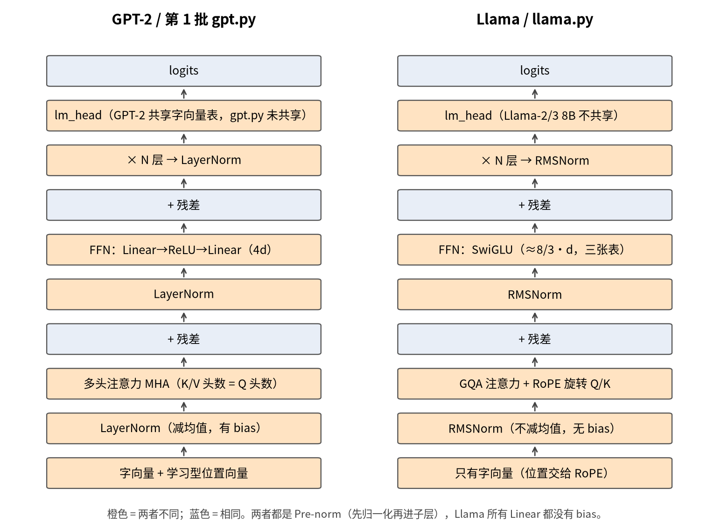
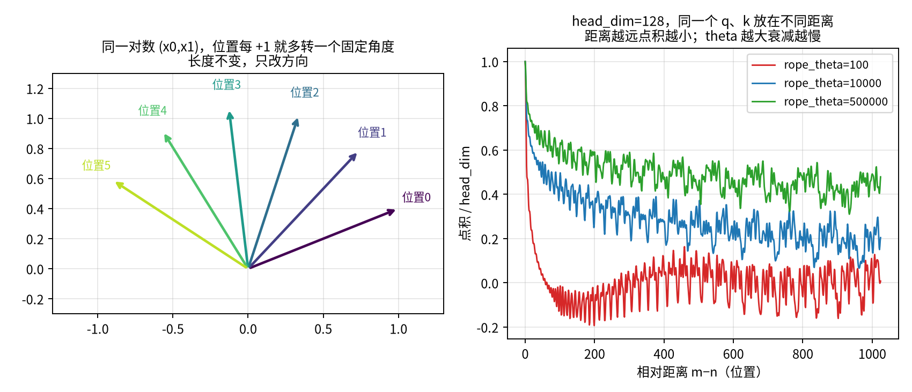
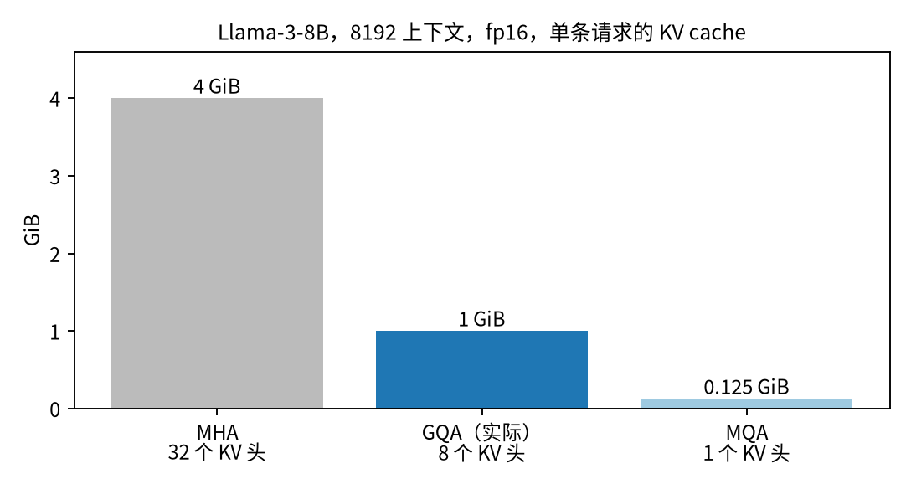
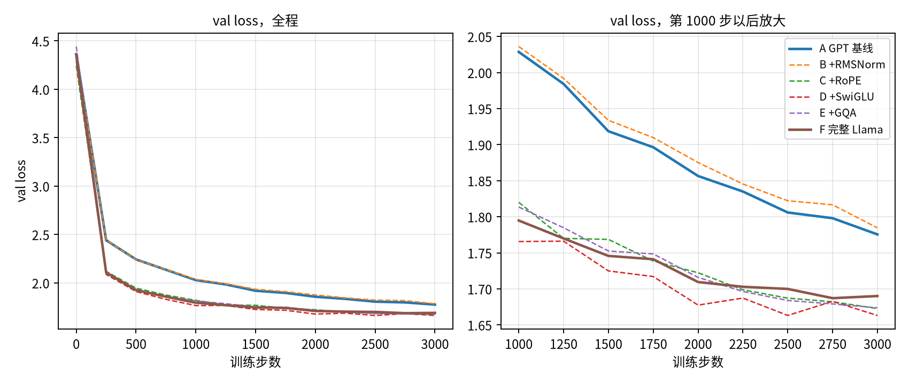

# 第2批讲义：把 GPT 改成 Llama

<p class="sub">阶段 1 · 第 3 周 · 自顶向下 · 按需回溯</p>

## 怎么读这份讲义

第 1 批你已经把 `gpt.py` 从头拆到了底。这一批反过来用它：**以 `gpt.py` 为起点，一步一步改成 Llama**。你在 Ollama / llama.cpp 里跑的 Llama、Qwen、Mistral，骨架都是这一批改出来的样子。

每一章都按同一个顺序走：

1. **哪里不一样、为什么**：Llama 和 GPT 在这一处的差别，解决什么问题
2. **回溯框**：用到的数学只讲够用的那一点，配小数字例子和能跑的代码（黄色框）
3. **结论性公式**：不要求手推，完整推导统一写“留给深挖章节 A”
4. **代码 diff**：`gpt.py` → `llama.py` 改了哪几行
5. **常见坑** 和 **小结**

本批文件（所有数字都来自真实运行输出）：

| 文件 | 作用 |
|---|---|
| `llama.py` | 主角。默认参数 = 第 1 批的 GPT；每个改动一个开关 |
| `ablation.py` | 消融实验：同样步数下逐项替换，自动出表 |
| `snippets.py` | 所有回溯框里的小例子 |
| `hf_config.py` | 对照 Hugging Face / GGUF 配置字段，算 KV cache |
| `figs.py` | 生成本讲义的 4 张图 |

```bash
python llama.py --steps 3000                                  # GPT 基线
python llama.py --steps 3000 --norm rms --pos rope --ffn swiglu --kv_heads 2 --bias 0   # Llama
python ablation.py 3000                                       # 全部消融（CPU 约 32 分钟）
```

第一次运行会自动下载 tinyshakespeare 到 `input.txt`（数据不入库）。

---

## 第 1 章 总览：GPT 块和 Llama 块差在哪

先看全局。两者的大骨架完全一样：**字向量 → N 个 Transformer 块（注意力 + FFN，各带残差）→ 归一化 → lm_head → logits**。不同的是块里的“零件”：



| 零件 | GPT-2（= 第 1 批 gpt.py） | Llama | 解决什么 | llama.py 开关 |
|---|---|---|---|---|
| 归一化位置 | Pre-norm | Pre-norm（相同） | 深层稳定训练 | —— |
| 归一化方式 | LayerNorm | **RMSNorm** | 更省、同样稳 | `--norm rms` |
| 位置信息 | 学习型位置 embedding | **RoPE** 旋转 Q/K | 相对位置、能外推 | `--pos rope` |
| FFN | Linear→ReLU→Linear（4d） | **SwiGLU**（≈8/3·d） | 同参数下效果更好 | `--ffn swiglu` |
| 注意力 | MHA | **GQA** | KV cache 变小 | `--kv_heads 2` |
| bias | 有 | **全部去掉** | 更简洁，几乎不掉点 | `--bias 0` |
| 输入/输出表共享 | GPT-2 共享 | Llama-2/3 的 7B/8B 不共享（Llama-3.2 的 1B/3B 共享） | 小模型省参数 | `--tie 1` |

说明两点：

- **Pre-norm 不是 Llama 的发明。** 原始 Transformer（2017）是 Post-norm（先加残差再归一化），GPT-2 已经改成 Pre-norm，你的 `gpt.py` 也是。所以这一项“不用改”。
- **为什么这几项都被保留下来？** 它们各自单独看都只是小改进，但都满足“几乎不增加成本、大模型上稳定有效”。现在的开源模型（Llama、Qwen、Mistral、DeepSeek 的稠密部分）基本都是这一套。

**小结**：Llama ≈ GPT + 四个零件替换（RMSNorm、RoPE、SwiGLU、GQA）+ 去 bias。下面一章换一个。

---

## 第 2 章 LayerNorm → RMSNorm

**哪里不一样**：LayerNorm 做两件事：①减均值（把中心挪到 0）②除以标准差（把散开程度调成 1），再乘 weight、加 bias。RMSNorm **只做第 ②件的简化版**：不减均值，直接除以“均方根”，只乘 weight，没有 bias。

**为什么**：论文（Zhang & Sennrich, 2019）发现 LayerNorm 起作用的主要是“把尺度校准”，减均值那一步可有可无。去掉它，少算一个均值、少一组参数，在 GPU 上更快；大模型实测效果不变，训练同样稳定。

<div class="back" markdown="1">
**回溯框 2：均方根（RMS）**

名字倒着读就是算法：**平方 → 均值 → 开根号**。

还是第 1 批的 [2, 4, 6, 8]：

- 平方：[4, 16, 36, 64]
- 均值：(4 + 16 + 36 + 64) ÷ 4 = **30**
- 开根号：√30 ≈ **5.477**
- 每个数除以它：[0.365, 0.730, 1.095, 1.461]

对比 LayerNorm 的结果 [−1.34, −0.45, 0.45, 1.34]：RMSNorm 后**不再以 0 为中心**（全是正数），但“大小尺度”被统一到 1 左右了（平方均值 = 1）。

```python
h = torch.tensor([2., 4., 6., 8.])
print(h / torch.sqrt((h ** 2).mean() + 1e-5))   # tensor([0.3651, 0.7303, 1.0954, 1.4606])
print(F.layer_norm(h, (4,)))                     # tensor([-1.3416, -0.4472, 0.4472, 1.3416])
```

`1e-5` 就是配置里的 `rms_norm_eps`：防止全 0 向量时除以 0。
</div>

**结论性公式**：RMSNorm(x) = x ÷ √(mean(x²) + ε) × weight（推导为什么不减均值也行，留给深挖章节 A）

**代码 diff**（`llama.py`）：

```diff
+class RMSNorm(nn.Module):
+    def __init__(self, dim, eps=1e-5):
+        super().__init__(); self.eps = eps; self.weight = nn.Parameter(torch.ones(dim))
+    def forward(self, x):
+        return x * torch.rsqrt(x.pow(2).mean(-1, keepdim=True) + self.eps) * self.weight
-        self.ln1, self.ln2 = nn.LayerNorm(n_embd), nn.LayerNorm(n_embd)
+        self.ln1, self.ln2 = Norm(n_embd), Norm(n_embd)      # Norm 按 --norm 选
```

`torch.rsqrt` = 1/√，一步算完。

**常见坑**：

- **eps 要和权重配套。** Llama-3 是 1e-5，Qwen2.5 是 1e-6。llama.cpp 加载时打印的 `f_norm_rms_eps` 就是它；自己转换模型填错会让输出轻微变差，很难发现。
- **混合精度时在 float32 里算。** 平方容易在 fp16 里溢出，HF 的实现会先 `.float()` 再算，最后转回去。
- 最后一层 `ln_f` 也要换成 RMSNorm，别只换块里的两个。

**小结**：RMSNorm = 只保留“尺度校准”的 LayerNorm，更省、同样稳。

---

## 第 3 章 学习型位置 embedding → RoPE

**哪里不一样**：`gpt.py` 有一张 64 行的 `pos_emb` 表，第 m 个位置就**加上**第 m 行。Llama 删掉这张表，改成在注意力里把 **Q 和 K 按位置“旋转”** 一个角度（Rotary Position Embedding，RoPE，Su 等 2021）。

**为什么**：学习型位置表有两个毛病：

1. **只认绝对位置。** 但语言里更重要的是“这个词离我多远”（相对位置）。
2. **不能超出训练长度。** 表只有 64 行，第 65 个位置根本没有向量可加。你的 `gpt.py` 生成时要 `idx[:, -block_size:]` 截断，就是这个原因。

RoPE 用旋转把位置编进 Q、K，**点积自动只依赖相对距离**，而且任何位置都能算出一个角度，没有“表的尽头”。

<div class="back" markdown="1">
**回溯框 3a：sin、cos 和二维旋转**

平面上一个点 (x, y)，绕原点逆时针转 θ 角，新坐标是：

x' = x·cos θ − y·sin θ　　y' = x·sin θ + y·cos θ

只需记住几个值：cos 30° = 0.866，sin 30° = 0.5；cos 90° = 0，sin 90° = 1。

- (1, 0) 转 90° → (0, 1)：从“正右”转到“正上”
- (2, 1) 转 30° → (1.232, 1.866)，长度都是 √5 ≈ 2.236：**旋转不改长度，只改方向**

**复数直觉**：把 (x, y) 看成复数 x + yi，旋转 θ 就是乘上 cos θ + i·sin θ。(2 + i) × (0.866 + 0.5i) 算出来正好也是 1.232 + 1.866i。Meta 原版 Llama 代码就是用复数乘法写的 RoPE。

```python
def rot(x, y, deg):
    t = math.radians(deg); return (x*math.cos(t) - y*math.sin(t), x*math.sin(t) + y*math.cos(t))
print(rot(2, 1, 30))                                   # (1.2321, 1.8660)
print(complex(2, 1) * complex(math.cos(math.radians(30)), math.sin(math.radians(30))))   # 同上
```
</div>

<div class="back" markdown="1">
**回溯框 3b：为什么旋转后点积只看相对距离**

第 1 批讲过：点积 = 两个向量“方向有多接近”。如果把 q 转 a 度、k 转 b 度，它们之间的**夹角只变了 a − b**。

RoPE 规定：位置 m 的向量转 m×（固定步长）。那么位置 m 的 q 和位置 n 的 k，夹角只多了 (m − n)×步长，**和 m、n 各自是多少无关**。

实测（一对数，每个位置转 20°，q = (1, 2)，k = (3, −1)）：

| q 的位置 | k 的位置 | 相对距离 | 点积 |
|---|---|---|---|
| 5 | 3 | 2 | −3.7335 |
| 102 | 100 | 2 | **−3.7335**（完全相同） |
| 3 | 5 | −2 | 5.2656（方向反了，值不同） |

所以注意力打分天然就是“相对位置”的。V 不旋转，因为 V 是“被拿走的内容”，不参与打分。
</div>

<div class="back" markdown="1">
**回溯框 3c：多组不同转速，像钟表的秒针、分针、时针**

一对数只能转一个角度，转满 360° 就和 0° 分不清了。RoPE 把每个头的 head_dim 个数**两两分组**，每组转速不同：第 i 组每个位置转 θ^(−2i/d) 弧度（θ 就是 `rope_theta`，默认 10000）。

`llama.py` 里 head_dim = 16，有 8 组，转速（弧度/位置）实测：

```text
1.0000, 0.3162, 0.1000, 0.0316, 0.0100, 0.0032, 0.0010, 0.0003
```

最快的一组每个位置转 1 弧度（约 57°，像秒针，分辨近距离），最慢的一组要约 **19869** 个位置才转一圈（像时针，分辨远距离）。真实模型 head_dim = 128：θ = 10000 时最慢一组一圈约 54410 个位置；Llama-3 的 θ = 500000 时约 **256 万**个位置。

**θ 越大 → 整体转得越慢 → 远距离的位置越不容易“绕回来撞车”**，所以长上下文模型都把 θ 调大。
</div>



右图是把同一个 q、k 放在不同距离上的点积（head_dim = 128）：**距离越远，点积整体越小**（远处的字默认少关注一点），θ 越大衰减越慢。θ = 100 时 200 个位置后就衰减到 0 附近，长文本就看不远了。

**结论性公式**：对位置 m 的 q（以及 k）每两维一组，第 i 组转 m·θ^(−2i/d) 弧度；于是 q_m · k_n 只依赖 m − n。（复数乘法的完整推导留给深挖章节 A）

**代码 diff**：

```diff
-        self.pos_emb = nn.Embedding(block_size, n_embd)
-        x = self.tok_emb(idx) + self.pos_emb(torch.arange(T))
+        x = self.tok_emb(idx)                                  # 不再加位置向量
+def rope_cache(head_dim, T, theta):
+    inv_freq = 1.0 / (theta ** (torch.arange(0, head_dim, 2).float() / head_dim))
+    ang = torch.outer(torch.arange(T).float(), inv_freq)       # (T, hd/2) 每个位置每组的角度
+    return ang.cos(), ang.sin()
+def apply_rope(x, cos, sin):
+    x1, x2 = x[..., 0::2], x[..., 1::2]                        # 两两配对
+    return torch.stack([x1*cos - x2*sin, x1*sin + x2*cos], -1).flatten(-2)
         # 注意力里，算打分之前：
+        q, k = apply_rope(q, cos[:T], sin[:T]), apply_rope(k, cos[:T], sin[:T])
```

**长度外推实测**：训练长度 64。学习型位置的模型在长度 128 上根本跑不了（表只有 64 行）；RoPE 模型可以直接算，val loss 为 1.9068（完整 Llama；训练长度 64 上是 1.6901）。能跑但会变差，这就是为什么真实模型还要配合“调大 θ / YaRN 之类的缩放 + 继续训练”才能把上下文真正拉长。

**和你的 llama.cpp 经验对上**：GGUF 里的 `llama.rope.freq_base`（日志里的 `freq_base`）就是 θ；`--rope-freq-base`、`--rope-scaling` 这些参数就是在改这里的转速。乱改 θ 而不重新训练，模型会胡言乱语，因为它学会的是“这个转速下的相对距离”。

**常见坑**：

- **只转 Q、K，不转 V。**
- **配对方式有两种。** 本讲义（和 Meta 原版）用相邻配对 (0,1)(2,3)…；Hugging Face 用前后半配对 (0, d/2)(1, d/2+1)…（`rotate_half`）。两种数学上等价，但**权重要对应重排**。llama.cpp 的 `convert_hf_to_gguf.py` 对 Q/K 权重做 permute，就是在处理这件事。
- **推理用 KV cache 时，新 token 要按它的真实位置转**，不能每次都从 0 开始算。

**小结**：RoPE 把位置变成“旋转角度”，注意力打分自动只看相对距离；θ 控制转速，决定能看多远。

---

## 第 4 章 ReLU FFN → SwiGLU

**哪里不一样**：`gpt.py` 的 FFN 是两张表夹一个 ReLU：64 → 256 → 64。Llama 用 **SwiGLU**：**三张表**，其中两张并行地把 x 升维，一路过 SiLU 当“门”，另一路是“内容”，两路**逐个相乘**，再用第三张表降回去。

**为什么**：Shazeer（2020）在同参数量下对比了一批 FFN 变体，带门控的（GLU 家族）效果稳定更好，SwiGLU 是其中之一。论文自己的解释是“我们不知道为什么好，归功于神的恩典”，这是真实原话。直觉上：门让模型对每个隐藏单元**按输入决定开多大**，比 ReLU 的“正数全开、负数全关”更细腻。

<div class="back" markdown="1">
**回溯框 4：sigmoid、SiLU 和门控相乘**

**sigmoid**：σ(x) = 1 / (1 + e^(−x))，把任何数压到 0~1 之间，像一个“开合程度”：σ(−2) = 0.119，σ(0) = 0.5，σ(2) = 0.881。

**SiLU（也叫 Swish）**：SiLU(x) = x · σ(x)。像一个“圆滑的 ReLU”：

| x | ReLU | SiLU |
|---|---|---|
| −2 | 0 | −0.238（负数不完全归零） |
| 0 | 0 | 0 |
| 2 | 2 | 1.762 |

**门控相乘**：两个同样长的向量，对应位置相乘（不是点积，不求和）。门 gate = [−3, 0.5, 4]，内容 up = [2, 2, 2]：

- SiLU(gate) = [−0.142, 0.311, 3.928]
- 逐个相乘：[−0.285, 0.622, 7.856]

第 1 个单元几乎被“关掉”，第 3 个被“放大”。门的开合由输入 x 本身决定。

```python
gate, up = torch.tensor([-3., 0.5, 4.]), torch.tensor([2., 2., 2.])
print(F.silu(gate) * up)     # tensor([-0.2846, 0.6225, 7.8561])
```
</div>

**结论性公式**：SwiGLU(x) = W2 · ( SiLU(W1·x) ⊙ (W3·x) )，⊙ 是逐个相乘。

**为什么隐藏维是 8/3·d**：原 FFN 两张表，参数 2 × d × 4d = 8d²。SwiGLU 有三张表，参数 3 × d × h。要相等：3dh = 8d² → **h = 8/3·d**。我们 d = 64：

- ReLU FFN（无 bias）：2 × 64 × 256 = **32768**
- SwiGLU，h = 8/3 × 64 ≈ 170.7，凑成 4 的倍数 **172**：3 × 64 × 172 = **33024**，几乎一样

**代码 diff**：

```diff
-        self.net = nn.Sequential(nn.Linear(C, 4*C), nn.ReLU(), nn.Linear(4*C, C))
+        hidden = 4 * math.ceil(int(8 * C / 3) / 4)               # 64 → 172
+        self.w1 = nn.Linear(C, hidden, bias=False)                # gate
+        self.w3 = nn.Linear(C, hidden, bias=False)                # up
+        self.w2 = nn.Linear(hidden, C, bias=False)                # down
+    def forward(self, x):
+        return self.w2(F.silu(self.w1(x)) * self.w3(x))
```

**常见坑**：

- **真实模型的 intermediate_size 不一定是 8/3·d。** 8/3 只是“对齐原 FFN 参数量”的起点，之后可以再乘系数、再凑成 256/1024 的倍数。Llama-3-8B：d = 4096，8/3·d ≈ 10922，实际 `intermediate_size` = **14336**（= 3.5d），刻意加大了 FFN。
- **名字对应**：HF 里叫 `gate_proj / up_proj / down_proj`，Meta 原版叫 `w1 / w3 / w2`，GGUF 里是 `ffn_gate / ffn_up / ffn_down`。`w3` 是 up，不是 down，很容易搞反。
- 配置里 `hidden_act: "silu"` 指的就是门那一路的激活。

**小结**：SwiGLU = 一路当门、一路当内容、逐个相乘；隐藏维取 ≈ 8/3·d 让参数量不变。

---

## 第 5 章 MHA → GQA

**哪里不一样**：`gpt.py` 有 4 个头，**每个头都有自己的 Q、K、V**。GQA（Grouped-Query Attention，Ainslie 等 2023）让**几个 Q 头共用一组 K/V**。`llama.py --kv_heads 2`：4 个 Q 头分成 2 组，每组 2 个 Q 头共享 1 份 K/V。

**为什么**：训练时影响不大，问题出在**推理**。生成每个新 token 时，前面所有 token 的 K 和 V 要缓存起来（**KV cache**），不然每步都要从头算。这份缓存的大小和 K/V 头数成正比，长上下文、多并发时它比模型权重还占显存，而且每生成一个 token 都要把它从显存读一遍，读得越多越慢。K/V 头少了，缓存直接按比例缩小。

<div class="back" markdown="1">
**回溯框 5：分组共享 = 复制一下再用**

代码上 GQA 非常简单：K、V 只算 `kv_heads` 份，然后**复制**到和 Q 头一样多，后面的注意力代码一字不改。

```python
k = torch.arange(2).view(1, 2, 1, 1).float()    # 2 个 KV 头，内容分别记作 0、1
print(k.repeat_interleave(2, dim=1).flatten())   # tensor([0., 0., 1., 1.])
# Q 头 0、1 用 KV 头 0；Q 头 2、3 用 KV 头 1
```

**KV cache 大小公式**（每个 token）：

2（K 和 V）× 层数 × KV 头数 × 每头维度 × 每个数的字节数
</div>

**算一个真实数字：Llama-3-8B**（32 层，32 个 Q 头，**8 个 KV 头**，每头 128 维，fp16 每数 2 字节）：

| 方案 | KV 头数 | 每个 token | 8192 上下文 | 32 个并发 × 8192 |
|---|---|---|---|---|
| 假如 MHA | 32 | 512 KiB | **4.000 GiB** | 128 GiB |
| **GQA（实际）** | 8 | 128 KiB | **1.000 GiB** | 32 GiB |
| 假如 MQA | 1 | 16 KiB | 0.125 GiB | 4 GiB |



（数字由 `hf_config.py` 算出。）GQA 让 KV cache **缩小 4 倍**。同样结构若开到 128K 上下文（Llama-3.1-8B 就是），fp16 缓存是 16 GiB，比 8B 模型 fp16 权重本身（约 16 GB）还大。Qwen2.5-7B 只有 4 个 KV 头，8192 上下文只要 0.438 GiB。

**和你的 Ollama / llama.cpp 经验对上**：

- GGUF 里的 `llama.attention.head_count_kv`，llama.cpp 日志里的 **`n_head_kv`**，就是 KV 头数；`n_head / n_head_kv` 就是日志里的 `n_gqa`（Llama-3-8B 是 4）。
- 加载时日志里 `KV self size = ... MiB` 就是上面的公式乘以你设的上下文长度。Ollama 调大 `num_ctx` 显存就涨，原因在这里。
- Ollama 的 `OLLAMA_KV_CACHE_TYPE=q8_0`（llama.cpp 的 `-ctk q8_0 -ctv q8_0`）把每个数从 2 字节降到约 1 字节，Llama-3-8B 8192 上下文约 0.5 GiB。GQA 是“少存几个头”，量化缓存是“每个数存小一点”，两者可以叠加。

**代码 diff**：

```diff
-        self.heads = nn.ModuleList([Head(head_size) for _ in range(num_heads)])
+        self.q = nn.Linear(C, H * hd, bias=False)
+        self.k = nn.Linear(C, KV * hd, bias=False)       # 只有 KV 个头
+        self.v = nn.Linear(C, KV * hd, bias=False)
         ...
+        if KV != H:
+            k = k.repeat_interleave(H // KV, dim=1); v = v.repeat_interleave(H // KV, dim=1)
```

（`llama.py` 顺便把第 1 批“每个头一个 Head 对象、循环再拼接”改成了一次算完所有头再 `view` 拆开，结果等价、速度更快，这也是所有真实实现的写法。）

**常见坑**：

- `n_head` 必须是 `kv_heads` 的整数倍（`llama.py` 里有 assert）。
- **先 RoPE 再复制**和**先复制再 RoPE** 结果一样，但缓存里存的是复制前、旋转后的 K，才省显存。
- GQA 主要省的是推理显存和带宽，**训练时省的计算量很小**，别指望它让训练变快。
- 顺带一句：**MQA**（Multi-Query，所有 Q 头共用 1 份 K/V）是 GQA 的极端情况，最省但效果掉得多；**MLA**（DeepSeek-V2/V3 的多头潜在注意力）是把 K/V 压缩成一个小向量再缓存，留到后面讲 DeepSeek 时再拆。

**小结**：GQA = 多个 Q 头共用一份 K/V，KV cache 按比例缩小，效果几乎不掉。

---

## 第 6 章 消融实验：逐项替换，看真实 loss

**做法**：同一份数据、同一个随机种子（1337）、同样的超参（batch 32，上下文 64，d = 64，4 头 4 层，lr 1e-3，AdamW），**都训练 3000 步**，每次多换一个零件。loss 是在 50 个随机 batch 上的平均。运行 `python ablation.py 3000` 即可复现（这台机器 2 核 CPU，每个约 3–4 分钟）。

| 运行 | 累积改动 | 参数量 | train | val | Δval vs A | KV cache / token（fp32） |
|---|---|---|---|---|---|---|
| A | GPT 基线（gpt.py 同构） | 211,777 | 1.5992 | 1.7755 | +0.0000 | 2048 B |
| B | +RMSNorm | 211,201 | 1.6077 | 1.7846 | +0.0091 | 2048 B |
| C | +RoPE（去掉位置表） | 207,105 | 1.4951 | 1.6727 | -0.1028 | 2048 B |
| D | +SwiGLU | 208,481 | 1.4386 | 1.6631 | -0.1124 | 2048 B |
| E | +GQA（4 Q 头 / 2 KV 头） | 192,097 | 1.4639 | 1.6737 | -0.1018 | 1024 B |
| F | +去 bias = 完整 Llama | 190,144 | 1.4488 | 1.6901 | -0.0855 | 1024 B |
| A 换种子 2 | 同上结构，只换随机种子 | 211,777 | 1.5855 | 1.7603 | -0.0152 | 2048 B |
| F 换种子 2 | 同上结构，只换随机种子 | 190,144 | 1.4544 | 1.6556 | -0.1200 | 1024 B |



**怎么读这张表**：

- 逐项相对上一行的 val 变化：+RMSNorm +0.0091；+RoPE -0.1119；+SwiGLU -0.0096；+GQA +0.0107；+去 bias = 完整 Llama +0.0163。
- 完整 Llama（F）对 GPT 基线（A）：val 1.6901 vs 1.7755，差 -0.0855；参数量 190,144 vs 211,777（少 21,633，主要来自删掉 64×64 的位置表、减少 K/V 投影和去 bias）。
- 两个种子平均：A 1.7679，F 1.6728，差 -0.0951，比单种子的差距更可信。
- KV cache：GQA 把每 token 缓存从 2048 字节减半到 1024 字节，这一项在任何规模都成立。
- 耗时：A 200s，F 199s（CPU 小模型上几乎一样；Llama 结构的速度收益在大模型推理时读写 KV cache 上，这里体现不出）。

**为什么除了 RoPE，其余几项差距都很小，这是正常的**：

- **RoPE 是这里唯一明显的收益**（val 约降 0.1）。字符级任务里“前一个字母是什么、两个字母前是什么”这种**相对位置**信息特别重要，RoPE 直接把它编进了打分；学习型位置表要从 3000 步里自己学出 64 个位置的关系，学得慢。
- RMSNorm、GQA、去 bias 的设计目标本来就不是“降 loss”，而是**省计算、省显存、训练稳**，在 0.2M 参数、64 字上下文、4 层的模型上体现不出来。表里 +GQA、去 bias 让 val 略微上升，可能因为 K/V 投影和 bias 的参数确实少了（D → F 少了 18,337 个），也可能只是噪声，见下一条。
- SwiGLU 的优势通常在大模型、长训练上才稳定显现。
- **噪声和这些小差距一样大。** 只换随机种子，同样的结构 val loss 就能差 0.035。小于这个量级的差别不能当结论，严肃的比较要多种子、更多步、更大模型。

**外推（长度 128，训练长度 64）**：C 1.8133 → F 1.9068。能跑但都比训练长度上差，见第 3 章。

**生成样例**（完整 Llama，3000 步）：

```text
LUCDIO:
What to you for ere tong, one and bed.

HERMIONE:
My gorrimity comes Warwick's hold,
How so,
Two look in
cerefer fames, my love not like colve my false of the presence,
Shall butt; nor his, but well should thus alone;
Now, like wunder eyes my diff thou hast so
she come, unmally that that whi
```

**小结**：每一项都能独立开关、独立跑通；在这个小模型上完整 Llama val 比 GPT 低 0.085，收益几乎全部来自 RoPE。真实大模型选这套组合，看的是效果、速度、显存的总账，不是某个小实验的 loss。

---

## 第 7 章 对照真实模型：配置字段对应

`hf_config.py` 把 `llama.py` 的参数和 Hugging Face `config.json`、GGUF 元数据对上（真实模型数值按官方 config.json 抄写，以官方仓库为准；不需下载模型）：

| HF config.json 字段 | 我们 | Llama-3-8B | Qwen2.5-7B | llama.py | GGUF 键 / llama.cpp 日志 |
|---|---|---|---|---|---|
| `hidden_size` | 64 | 4096 | 3584 | `--n_embd` | `embedding_length` / `n_embd` |
| `intermediate_size` | 172 | 14336 | 18944 | ≈8/3·d | `feed_forward_length` / `n_ff` |
| `num_hidden_layers` | 4 | 32 | 28 | `--n_layer` | `block_count` / `n_layer` |
| `num_attention_heads` | 4 | 32 | 28 | `--n_head` | `attention.head_count` / `n_head` |
| `num_key_value_heads` | 2 | 8 | 4 | `--kv_heads` | `attention.head_count_kv` / `n_head_kv` |
| `rope_theta` | 10000 | 500000 | 1000000 | `--rope_theta` | `rope.freq_base` / `freq_base` |
| `rms_norm_eps` | 1e-5 | 1e-5 | 1e-6 | RMSNorm eps | `layer_norm_rms_epsilon` / `f_norm_rms_eps` |
| `max_position_embeddings` | 64 | 8192 | 32768 | `--block_size` | `context_length` / `n_ctx_train` |
| `vocab_size` | 65 | 128256 | 152064 | 字符表 | 词表 / `n_vocab` |
| `tie_word_embeddings` | false | false | false | `--tie` | 是否有独立 `output.weight` |
| `hidden_act` | silu | silu | silu | `--ffn swiglu` | —— |
| `attention_bias` | false | false | 仅 QKV 有 | `--bias` | 是否有 `attn_q.bias` |

（GGUF 键前面都有架构前缀，如 `llama.attention.head_count_kv`。）

几个值得注意的地方：

- **每头维度 = hidden_size ÷ num_attention_heads**：Llama-3-8B 是 128，Qwen2.5-7B 是 3584 ÷ 28 = 128，我们是 16。
- **Qwen2.5 和 Llama 几乎一模一样**，主要区别是 Q/K/V 投影带 bias、θ 更大、eps 更小、KV 头更少。llama.cpp 能用几乎同一套代码跑它们，原因就在这张表。
- 以后看到任何新模型，先打开 `config.json` 对这张表，就能马上说出它“是不是 Llama 那一套、改了哪几个零件”。

**小结**：你在 Ollama 日志里见过的那些参数，现在每一个都能在 `llama.py` 里找到对应的一行代码。

---

## 本批完成标准

1. **跑通**：`python llama.py --steps 3000 --norm rms --pos rope --ffn swiglu --kv_heads 2 --bias 0` 和 `python ablation.py 3000`（或让我帮你跑），得到和第 6 章同量级的表。

2. **用自己的话说出 4 个改动各解决什么问题**（每个一两句话，不需要公式）：

    - RMSNorm 比 LayerNorm 少了什么？为什么少了也没关系？
    - RoPE 为什么能让注意力只看相对距离？`rope_theta` 调大意味着什么？
    - SwiGLU 的“门”是什么？隐藏维为什么是 8/3·d？
    - GQA 省的是什么？Llama-3-8B 在 8192 上下文下 KV cache 大约多大，MHA 的话呢？

3. **可选实验**（任选一个，说说你看到了什么）：

    - 改 `--rope_theta`：试试 100 和 1000000。参考：θ = 100 时实测 val 1.6898（默认 θ = 10000 是 1.6901）。在 64 字上下文上差别会大吗？为什么？
    - 改 `--kv_heads`：试试 1（MQA）和 4（MHA）。参考：kv_heads = 1 时实测参数量 181,952、val 1.6723、KV cache 每 token 512 字节。
    - 用 `ollama show --modelfile` 或 llama.cpp 加载日志，找出你常用的一个模型的 `n_head_kv`、`freq_base`，算算它的 KV cache。

完成后把你的回答发给我，我点评后发下一批。

<p class="foot">深挖章节 A（以后再看）：RMSNorm 的梯度与“为什么不减均值也行” · RoPE 的复数推导与相对位置证明、NTK/YaRN 外推 · GLU 家族对比 · GQA 从 MHA 权重“均值池化”转换。素材已保存。</p>
